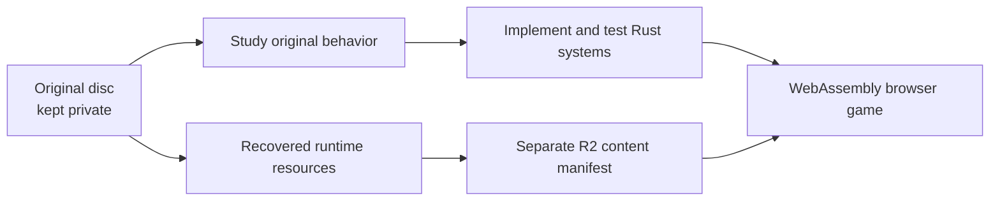

# Fury Remastered — ATV Offroad Fury 2 in your browser

**[Play Fury Remastered](https://furyremastered.com/) · [Screenshot dev log](https://furyremastered.com/devlog.html)**

Fury Remastered is an ongoing **Rust/WebAssembly port of ATV Offroad Fury 2** for desktop and mobile browsers. The project started with many hours spent riding these maps on PS2 and wanting that same ATV feel in something you can quickly open on your phone or play with friends.

Codex has helped with most of the implementation and reverse engineering. We work from the original PS2 disc, without the original source code, recovering the game's resources and behavior one system at a time. The original experience is the baseline; optional enhancements sit alongside the ongoing port.

**The public HTTPS build now unlocks all 40 original venue families in Freestyle:** eight environments, six stunt venues, eight Nationals, sixteen Supercross stadiums, Training, and Coonce Arena. The all-venue release was verified on the public app with its separate runtime content package. The browser port also supports all 26 original in-race quads, one-handed touch controls, online Freeride with up to four players, motorcycles, and a race preview on all 32 original race courses. Required resources load automatically, with no installation or disc-selection step.

**This is still a work in progress.** Racing, progression, saves, and parts of the original physics, animation, audio and rendering remain incomplete. It is a playable reconstruction, not a completed decompilation or a finished port.


*October 13 public build: riding Tioga Valley, captured from the deployed game in desktop Chromium.*

## What you can play today

| Feature | Current public build |
| --- | --- |
| **Freestyle riding** | All 40 original venue families are publicly available: eight ENV, six FREE, eight NAT, sixteen SX, Training and Coonce Arena. Their source terrain, sky, scenery and available vegetation are connected; racing rules, environmental behavior and full visual parity remain incomplete. |
| **Quads and riders** | All 26 original in-race quads, with their own resources, tuning and engine banks; male and female rider choices. Garage selections are available without the original unlock progression. |
| **Mobile controls** | One-handed throttle, steering and rider lean, with an optional second touch for braking/reverse and airborne tricks. A standard two-thumb layout is also available. |
| **Online multiplayer** | Up to four ATV riders in Freeride, drop-in style: host on any track and friends join from the invite link at any time, appearing beside you. Change ATV or track without leaving, and the ride carries on if anyone (including the host) drops or leaves. Remote riders have animated quads, spatial engine audio, overhead names and GPS markers. |
| **Motorcycles** | Single Player includes 20 choices across 16 bike designs and 50/125/250/500 profiles, including labeled Race/Pro setups. These use an authored two-wheel Rust controller (not recovered MX physics) with models, animation, sound and tuning values from **MX vs. ATV Unleashed**, not ATV2. Motorcycles are not yet available in multiplayer. |
| **Race preview** | Single Player → Race offers every original race course: eight Environment Nationals, eight Nationals and sixteen Supercross tracks, decoded from their own TDF route graphs with start straights, alternate lines and original start/finish gates. Countdown, laps, timing, radar and results are included. The ATV field includes four independently simulated CPU riders with recovered driving decisions. CPU corner speed on courses without authored speed limits, full original race rules and progression remain unfinished. |
| **GPS and speed HUD** | A configurable minimap combines terrain, heading, speed and preload feedback. Choose shape, corner, size and zoom; tap it to switch north-up/heading-up. |
| **Sound and settings** | All 21 original songs, per-quad engine audio, selected impact and train sounds, music selection and remappable keyboard/controller bindings. Music continues through the pause menu. |
| **Crash presentation and camera** | Settings → Extras offers Original, Crazy and opt-in Gorn crash modes, plus Tight/Original crash-camera framing. Camera shake is removed. Gorn adds severed rider parts and bounded terrain droplets only on severe impacts; recovery and original vehicle handling remain intact. Settings are saved locally. |
| **Quick return** | This browser remembers Garage selections, settings and the last successfully loaded Freestyle course. Home Screen app metadata and an install/help flow are included. |

The renderer now connects recovered materials, animated UVs, fog coverage, ice-reflection overlays and near-vegetation colors, alongside water and wheel effects. These are incremental rendering improvements; original lighting, distant vegetation/LOD, shadows and full-scene fidelity still need work. See [map evidence](research/MAP_FIDELITY.md).

## Ride from your phone

Open [Fury Remastered](https://furyremastered.com/), choose **Single Player → Freestyle**, and select your ride and map.

- **One finger by default:** touch anywhere on the game surface to hold throttle and brace. Drag sideways to steer and up/down to lean. Lift to coast and release preload through the original ramp gates.
- **Optional second touch:** while the primary finger stays held, another touch brakes and then reverses on the ground. In the air, the second finger opens a trick wheel: drag to a named trick and release to perform it. Return to the center to cancel; lifting the primary clears both.
- **Two-thumb layout:** set **Pause → Settings → Controls → One-handed mobile: Off**. The left thumb steers/leans; the right thumb accelerates/braces or drags down to brake/reverse. A saved Off is preserved.
- **Adjust the feel:** **Pause → Settings → Controls** includes saved Mobile steering response from 50% to 150%, defaulting to 85%.
- **Pause and Camera:** the on-screen buttons work independently, including a second-finger tap while driving. In multiplayer, opening the menu leaves the visible ride running; Single Player pauses its simulation.


*October 13 public build in a 390×844 Chromium viewport: Caribou Peak with the combined GPS and speed HUD.*

**GPS:** open **Pause → Settings → Display → Minimap configuration** for visibility, circular/square shape, top-right/bottom-left placement, size (96–224px), zoom (25–200%) and orientation. The map follows the detached rider during a wreck; in multiplayer it also shows the other riders. See [GPS settings and performance evidence](research/MINIMAP.md).

**Home Screen:** on iPhone/iPad, open the game in Safari and use **Share → Add to Home Screen**, keeping **Open as Web App** enabled if offered. The shortcut launches **Fury Remastered** with its matching icon. Other browsers show an install prompt when they provide one. Existing saved icons may need to be added again to refresh them.

Touch, portrait/landscape layouts and install-flow behavior have automated Chromium/WebKit coverage on the host Mac. Physical iOS/Android installation, sustained phone performance and Bluetooth controllers still need hands-on validation. The Home Screen flow does not establish offline play.

## Ride with friends

Choose **Multiplayer → Host Game**, enter a rider name (it is remembered), choose your quad/rider, then **Select Track** and **Ride**. You are riding straight away; leave the code blank for a random one or supply eight letters/digits. Share **Pause → Copy invite link** or the code. Friends open the invite (or **Join Game** with the code) whenever they like and appear beside a rider who is already there. The link keeps working: if everyone has left, opening it starts that room again on its track.

During a ride, **Pause → Change ATV and Rider** swaps your ride in place, and the host's **Pause → Select Track** moves everyone to another course. **Players → Spawn beside** meets up with a friend. Any rider who drops or reloads gets the same slot back within 30 seconds; if the host leaves, the next rider takes over and everyone keeps riding. The Arlington train runs on a shared relay clock, so it keeps moving for everyone regardless of who pauses.


*Earlier public Vancouver Ridge checkpoint: two riders in the same Freeride room. The current build adds GPS player markers, overhead names and late-join controls.*

This is an authored Rust multiplayer implementation using a Cloudflare room relay. Each rider simulates their own quad locally. Rider contacts use authored owner-local yawed-box collisions with spin and landings; server physics reconciliation, competitive racing and local split-screen remain unfinished. Automated two- and four-client public checks pass, but geographically separated latency and physical-phone sessions remain unverified. See [multiplayer implementation and evidence](research/MULTIPLAYER.md).

## Open a shared ride

[Start Tioga with a Honda 250EX and female rider](https://furyremastered.com/?mode=single&map=env02&quad=14&rider=female), or use **Pause → Copy ride link** to share the setup you are riding. **Copy invite link** joins that room automatically at any time, or reopens it on its track once everyone has left. Links can select map, vehicle, rider, player name, Single Player/Freeride, a multiplayer room, or the supported Race laps/CPU settings. Add `play=0` to open setup before starting.

See the [URL parameter reference and examples](research/PLAY_LINKS.md). Multiplayer remains ATV Freeride; motorcycles and the Race preview are Single Player.

## Motorcycles in Single Player

The garage also includes motorcycles whose resources and tuning come from the separate **MX vs. ATV Unleashed** disc. Their authored two-wheel controller (not a recovered MX controller) connects suspension, engine/gears, clutch, rider lean, preload, stunts, particles and wreck/recovery. Bike brands sharing a class profile do not imply separately recovered per-brand physics.


*Public motorcycle checkpoint, October 13: portrait browser riding and touch steering. This is a browser capture, not a physical-phone photograph.*

Use **V** for clutch on keyboard; existing lean, preload and stunt controls apply. The controller clutch defaults to left-stick press. Full original motorcycle-controller, animation and stunt parity are not established. See [motorcycle evidence and limits](research/MOTORCYCLES.md).

## Keyboard and controllers

**Pause → Settings → Controls** remaps keys, controller buttons, analog directions and combinations. Settings and Garage selections are stored in this browser; if storage is unavailable, the game still runs but those choices cannot persist across reloads.

| Action | Keyboard default | Controller default |
| --- | --- | --- |
| Accelerate / brake | W / S or up/down arrows | Bottom face button or right trigger / left face button or left trigger |
| Reverse | Keep holding S (or down arrow) once stopped | Bottom + left face buttons together |
| Steer | A / D or left/right arrows | Left stick horizontal or D-pad |
| Lean forward / back | Q / E or Left Shift | Left stick vertical or D-pad |
| Prepare a jump | Space hold/release, or quick back-to-forward lean | Quick back-to-forward lean at a jump |
| Stunt modifiers | In the air, hold J / K (add L for combos), then tap a direction | Right face / top face / left shoulder with a direction |
| Pause / camera / reset | Escape or P / C / R or Backspace | Start / right stick click / both shoulder buttons |

Press **H** (or the **Keys** button) while riding to show the keyboard controls card; it opens automatically on your first keyboard ride. Controller labels follow the browser's standard layout. See [controls](research/CONTROLS.md) and [touch gestures](research/TOUCH.md) for the full mappings and evidence.

## How the port works

The source is the USA v2.00 PS2 release, `SCUS_972.11`, with an empty symbol table. Recovering its assets and interpreting its machine instructions are separate parts of the work. Named routines from the first ATV game must be verified against this sequel build.



The browser runs the authored Rust port, not a PS2 emulator or the disc executable. The web layer connects WebGL2 rendering, Web Audio, menus and input. Codex helps investigate routines, implement systems and compare results; original instructions and tests are the evidence for a recovered component.

Selected physics, camera, animation, collision and rendering routines have comparisons against original instructions. **That is component evidence, not whole-game replay equivalence or a PS2-hardware comparison.** Full racing, progression/saves, stunt fidelity, remaining collision/water behavior, original audio mixing and full rendering fidelity are still open.

**Screenshot baseline — October 13, 2026:** the public app identifies [`0787b32`](https://github.com/nrgapple/atv-offroad-fury-2-web/commit/0787b32b505ce8edc5d98bbf719514fce57b4ed9), with passing [main CI and deployment](https://github.com/nrgapple/atv-offroad-fury-2-web/actions/runs/38457121147). Earlier public gates cover nine-map driving, all ATV selections, multiplayer late join/four-client replication, motorcycle touch steering and rider contacts, fog/reflections/materials, and pause/menu behavior. The screenshots above identify their own capture context; passing CI alone does not prove every gameplay system or physical-device behavior. Current component status is in the [handoff](HANDOFF.md); detailed evidence lives in the [deployment record](research/DEPLOYMENT.md) and [dev log](https://furyremastered.com/devlog.html).

## Follow development

The [screenshot dev log](https://furyremastered.com/devlog.html) records discoveries, changes, verification and limitations. Its older entries describe historical builds; the screenshots in this README are selected recent checkpoints.

For the implementation, start with [strategy](research/IMPLEMENTATION.md), [resources](research/RESOURCES.md) and [formats](research/FORMATS.md). System notes cover [movement](research/MOVEMENT.md), [collision](research/COLLISION.md), [wrecks](research/WRECK.md), [racing](research/RACING.md), [audio](research/AUDIO.md), [motorcycles](research/MOTORCYCLES.md) and [multiplayer](research/MULTIPLAYER.md).

## Working on the project

**Each new chat that edits this repository must use its own worktree and task branch, based on freshly fetched `origin/main`.** This includes documentation and release notes. Keep the shared checkout on `main`; do not inherit its current feature branch or share another chat's checkout. Put worktrees on the external SSD under `~/Projects/atv-worktrees/`. See [agent instructions](AGENTS.md#chat-worktrees-and-branches) for setup, delivery, and cleanup rules.

<details>
<summary>Developer setup, checks, and repository map</summary>

You need Rust with the `wasm32-unknown-unknown` target, rustfmt, Clippy, Python 3, and Node. Original-source audits also require the private local disc files. Preserve the existing SSD-backed `target/`, `web/dist/`, and `work/verification/` symlinks.

```sh
make verify  # Check source identity, reference revisions, and Git exclusions
make check   # Secrets/repository hygiene, Rust formatting, tests, Clippy, JS and Python tool tests
make web     # Build the authored browser app and development workbench
make serve   # Run the host-only development server on port 4173
```

`make serve` is **host-only access**, not a remote handoff. `BIND` and `PORT` can be overridden; binding to `0.0.0.0` alone doesn't make the service remotely reachable. Use the public HTTPS build for remote play.

Browser checks require Playwright, Chromium, and a running server:

```sh
PLAYWRIGHT_MODULE=/path/to/node_modules/playwright make browser-check
```

`ATV_TEST_URL` selects the test server. Optional `ATV_TEST_ISO` selects a private local disc for source-content checks. `make audit`, `make code-map`, and `make native-analyze` support deeper recovery work; see [HANDOFF.md](HANDOFF.md) for the local toolchain and commands.

| Folder | What's inside |
| --- | --- |
| `crates/atv-core/` | Shared Rust resource readers and game simulation |
| `crates/atv-web/` | Rust/WebAssembly bridge for the browser |
| `crates/atv-tools/` | Native tools for private-disc inspection and extraction |
| `web/` | Fullscreen game presentation and a separate `/workbench.html` inspector |
| `tools/` | Build, analysis, verification, and deployment helpers |
| `research/` | Shareable discoveries, evidence, and dev-log metadata |
| `private/`, `references/`, `work/` | Original source, analysis, references, and intermediate outputs; ignored by Git |

</details>

GitHub holds authored code and shareable notes. Required recovered runtime resources and approved screenshots live separately in Cloudflare R2. The disc image, BIOS, raw executable, reverse-engineering outputs, and reference checkouts stay private and outside GitHub/CI. GitHub Actions checks the authored build and deploys it to the public Cloudflare app; content uploads follow their own validation path.
