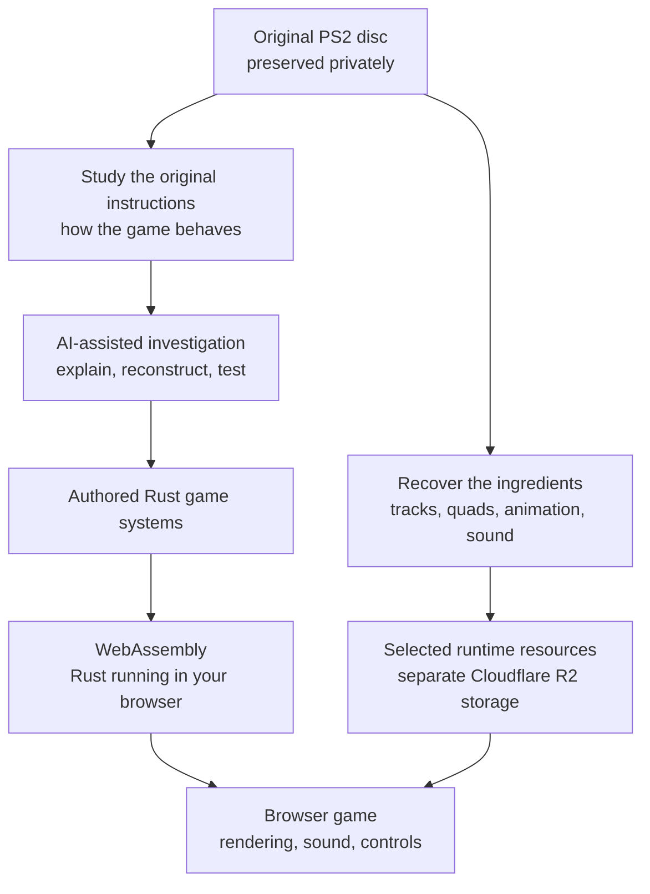
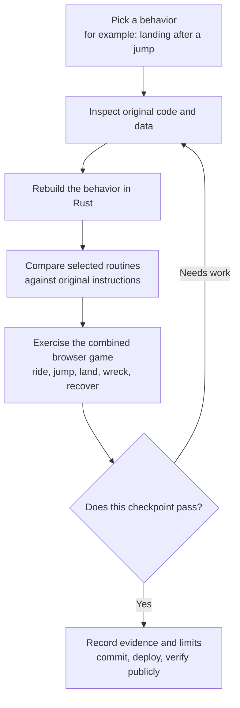
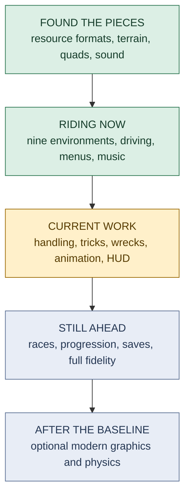

# ATV Offroad Fury 2 — from PS2 dust to browser dirt 🏁

We're bringing **ATV Offroad Fury 2** into the browser as a Rust game: the original trails, quads, music, and wonderfully reckless arcade riding, rebuilt one system at a time with AI-assisted reverse engineering.

**[Play the current build](https://atv-offroad-fury-2.champtoday.workers.dev/) · [Follow the screenshot dev log](https://atv-offroad-fury-2.champtoday.workers.dev/devlog.html)**

Both links are **public HTTPS**, accessible away from the development Mac. The game loads its required original resources automatically; you don't need to select a disc file.

There is already a rideable browser reconstruction with nine environments. **This is still a work in progress, not the complete game or a finished decompilation.** The goal is to recover the original experience first, then offer optional graphics and physics upgrades.


*An earlier public course capture. The screenshots here show real development checkpoints, rather than a promise of finished-game fidelity.*

## How do you turn a PS2 game into Rust?

Think of it as archaeology with a throttle. We have the original USA v2.00 game disc, but not its source code. Its executable contains the machine instructions the PS2 ran, with the original function names stripped away. There is no convenient `make_it_rust` button.

We work along two trails:

- **Recover what the game uses:** unpack its terrain, vehicles, textures, animations, tuning, and sound.
- **Recover what the game does:** study its instructions to understand suspension, grip, jumps, camera movement, tricks, crashes, and eventually race rules.

Then we write those systems in Rust and connect them to the recovered resources.



**AI is our research and coding partner.** It helps trace unfamiliar routines, propose readable explanations, implement Rust equivalents, and build comparisons. A plausible explanation is a starting point; the original instructions and test results decide whether it holds up.

Specialist reverse-engineering tools help turn the PS2 instructions into more readable code. Reference projects provide leads too, but a finding from the first ATV game must be checked against this exact sequel build. The [research notes](research/RESOURCES.md) explain the tools and their limits.

**The browser runs the Rust reconstruction.** It does not run the PS2 executable or a PS2 emulator. Rust compiles to WebAssembly—the browser's way of running this compiled game code—and the web layer handles graphics, audio playback, menus, and input.

## How we keep it feeling like the original

A quad that moves isn't automatically *this* quad. Update order, wheel contacts, rider weight, and tiny timing rules can change how a landing feels. We recover and check small pieces before trusting the combined ride.



These comparisons already cover selected vehicle, camera, animation, and collision routines. They are useful evidence, but **we haven't demonstrated whole-game replay equivalence to the PS2 original**. A component can match while the systems around it still need work.

## Where we are on the trail

The milestones overlap: finding an animation doesn't finish the trick system, and decoding a track doesn't make it a playable race.



| Part of the adventure | What works, and what remains |
| --- | --- |
| **Recovering the disc** | All 487 resource archives audited; 26 in-race quad meshes and 40 named terrains decode. These are recovery counts, not 40 playable maps. |
| **Getting out on the trails** | Nine environments load and drive in the public build, including Caribou Peak, Tioga Valley, Arlington, and Vancouver Ridge. Original terrain, sky, props, and vegetation are connected; visibility and distant detail still need work. |
| **Making the quad feel right** | Recovered drivetrain, suspension, grip, rider lean, and static obstacle contacts are connected. Landing fixes have reduced tire burial, but some overlap remains. |
| **Rider, tricks, and wipeouts** | ATV linkage, rider animation, stunt clips, and partial scoring/wreck/recovery behavior are connected. A failed Nac Nac through rider separation and recovery has passed public checks. Full flips, trick fidelity, and rider hand/foot placement remain unfinished. |
| **Menus, sound, and controls** | Title → Main Menu → Single Player → Freestyle works, with pause settings, remapping, engine audio, and all 21 songs. More modes, HUD behavior, and original sound mixing remain to recover. |
| **The complete game** | Full racing, progression, saves, remaining collision/water behavior, and original rendering fidelity are still ahead. Physical phones and Bluetooth controllers also need hands-on validation. |

**Public evidence snapshot:** [`e18a371e`](https://github.com/nrgapple/atv-offroad-fury-2-web/commit/e18a371e81b471137dd5fb1121b05d454584b1d0), October 12, 2026, passes CI 38312395498 and public checks for nine-map driving, source-correlated fog coverage, Caribou/Vancouver ice reflections, materials, wet/dry water behavior, menus/controls and copied-link Vancouver multiplayer. HTTPS hashes match 32 authored files and 405 served objects; the gallery has 118 entries and 99 screenshots. These are component and route checks, not full-map, full-game or original-hardware equivalence. Audio still lacks broader map ambience/surface scheduling, and source tree lighting is not complete. The [handoff](HANDOFF.md), [deployment record](research/DEPLOYMENT.md), [map evidence](research/MAP_FIDELITY.md) and [audio notes](research/AUDIO.md) hold detailed evidence and limitations.

## Yes, you can ride from your phone 📱

The browser build has a portrait layout and touch controls. Open the [public game](https://atv-offroad-fury-2.champtoday.workers.dev/), enter **Single Player → Freestyle**, and pick a map.

- **One finger by default:** touch anywhere to hold throttle and brace; drag sideways to steer and up/down to lean. Lift to coast and release preload through the recovered ramp rules. The same controls work in air. The small touch circle shows direction and a brief action cue.
- **Two-finger option:** set **Pause → One-handed mobile: Off**. An existing saved Off is preserved. Left thumb steers/leans; right thumb holds throttle and braces, or drags down to brake and then reverse after slowing.
- **Tricks with two fingers:** in the air, the right thumb switches to tricks. Swipe in eight directions or draw a clockwise/counterclockwise circle, then hold to extend the trick or lift to finish. A held thumb resumes drive on landing. See [gesture mappings](research/TOUCH.md).
- **Pause and Camera:** use the on-screen buttons.

Touch is a browser adaptation of the PS2 controls. Portrait and gesture checks pass in automated browsers; physical iOS Safari and Bluetooth-controller behavior remain unverified. The full original stunt system is still being rebuilt.


*Portrait play during the preceding public landing/wreck checkpoint. Touch controls use the two halves of the screen.*


*A host Chromium test capture of an unfinished Nac Nac. The recovered wreck/recovery sequence was subsequently checked publicly; this particular image comes from the host test.*

Keyboard and controllers work too. **Pause → Controls** lets you remap keyboard keys, controller buttons, analog directions, and button combinations; settings are saved in your browser.

| Action | Keyboard default | Controller default |
| --- | --- | --- |
| Accelerate / brake | W / S | Bottom face button or right trigger / left face button or left trigger |
| Steer | A / D or left/right arrows | Left stick horizontal or D-pad |
| Lean forward / back | Q / E or up/down arrows | Left stick vertical or D-pad |
| Reverse | R | Bottom + left face buttons together |
| Prepare a jump | Space hold/release, or quick back-to-forward lean | Quick back-to-forward lean at a jump |
| Stunt modifiers | J / K / L with a direction | Right face / top face / left shoulder with a direction |
| Pause / camera / reset | Escape / C / Backspace | Start / right stick click / both shoulder buttons |

Controller labels follow the browser's standard layout. For the complete mappings and original-control evidence, see [controls](research/CONTROLS.md) and [touch riding](research/TOUCH.md).

## Follow the rebuild

The [screenshot dev log](https://atv-offroad-fury-2.champtoday.workers.dev/devlog.html) records discoveries, improvements, bugs, and the evidence behind each checkpoint. Screenshots above come from selected development checkpoints; their captions distinguish public captures from host test captures.

Want to explore deeper? Start with the [implementation strategy](research/IMPLEMENTATION.md), [resource research](research/RESOURCES.md), and [recovered file formats](research/FORMATS.md). For a particular system, follow [movement](research/MOVEMENT.md), [collision](research/COLLISION.md), [wrecks](research/WRECK.md), or [audio](research/AUDIO.md).

## Working on the project

<details>
<summary>Developer setup, checks, and repository map</summary>

You need Rust with the `wasm32-unknown-unknown` target, rustfmt, Clippy, Python 3, and Node. Original-source audits also require the private local disc files. Preserve the existing SSD-backed `target/`, `web/dist/`, and `work/verification/` symlinks.

```sh
make verify  # Check source identity, reference revisions, and Git exclusions
make check   # Rust formatting, tests, Clippy, input tests, Python syntax
make web     # Build the authored browser app and development workbench
make serve   # Run the host-only development server on port 4173
```

`make serve` is **host-only access**, not a remote handoff. `BIND` and `PORT` can be overridden; binding to `0.0.0.0` alone doesn't make the service remotely reachable. Use the public HTTPS build for remote play.

Browser checks require Playwright, Chromium, and a running server:

```sh
PLAYWRIGHT_MODULE=/path/to/node_modules/playwright make browser-check
```

`ATV_TEST_URL` selects the test server. Optional `ATV_TEST_ISO` selects a private local disc for source-content checks. `make audit`, `make code-map`, and `make native-analyze` support deeper recovery work; see [HANDOFF.md](HANDOFF.md) for the local toolchain and commands.

| Folder | What's inside |
| --- | --- |
| `crates/atv-core/` | Shared Rust resource readers and game simulation |
| `crates/atv-web/` | Rust/WebAssembly bridge for the browser |
| `crates/atv-tools/` | Native tools for private-disc inspection and extraction |
| `web/` | Fullscreen game presentation and a separate `/workbench.html` inspector |
| `tools/` | Build, analysis, verification, and deployment helpers |
| `research/` | Shareable discoveries, evidence, and dev-log metadata |
| `private/`, `references/`, `work/` | Original source, analysis, references, and intermediate outputs; ignored by Git |

</details>

GitHub holds authored code and shareable notes. Required recovered runtime resources and approved screenshots live separately in Cloudflare R2. The disc image, BIOS, raw executable, reverse-engineering outputs, and reference checkouts stay private and outside GitHub/CI. GitHub Actions checks the authored build and deploys it to the public Cloudflare app; content uploads follow their own validation path.
