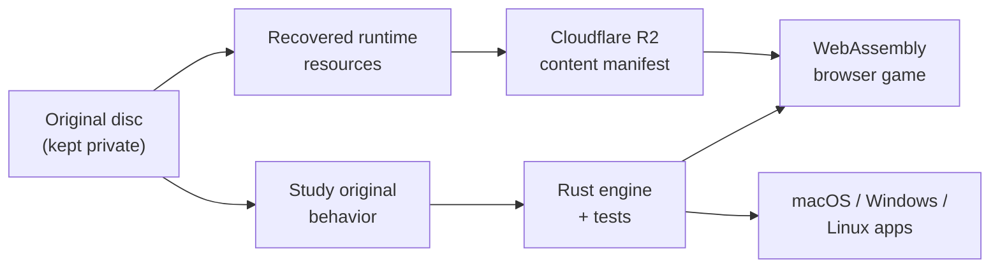

<p align="center">
  <a href="https://furyremastered.com/"></a>
</p>

<h3 align="center">ATV Offroad Fury 2, rebuilt in Rust. Play it in your browser, right now.</h3>

<p align="center">
  <a href="https://furyremastered.com/"></a>
  <a href="https://furyremastered.com/devlog.html"></a>
</p>

<p align="center">
  <a href="https://github.com/nrgapple/atv-offroad-fury-2-web/actions/workflows/ci.yml"></a>
  <a href="https://github.com/nrgapple/atv-offroad-fury-2-web/commits/main"></a>
  <a href="https://github.com/nrgapple/atv-offroad-fury-2-web/graphs/commit-activity"></a>
  <a href="https://github.com/nrgapple/atv-offroad-fury-2-web/releases"></a>
  
</p>

<p align="center">
  
</p>

Remember riding these hills on the PS2 for hours? **Fury Remastered** brings that ATV feel to anything with a browser: open a link on your phone, hold a thumb down and go. No install, no disc, no emulator. It's a from-scratch Rust/WebAssembly port, recovered system by system from the original USA v2.00 disc, and it ships to [furyremastered.com](https://furyremastered.com/) many times a day.

> [!NOTE]
> **This is a live, very active project.** Hundreds of changes land every week and each merge to `main` deploys straight to the public site. It's very playable, and it's still a reconstruction in progress, not a finished or complete port. See [what's still in the shop](#whats-still-in-the-shop).

## 📸 From the live build

<table>
  <tr>
    <td width="50%"><br><sub><b>Grand Canyon at dusk.</b> Freestyle, mid-jump.</sub></td>
    <td width="50%"><br><sub><b>Cactus country.</b> Tioga Valley with the GPS minimap.</sub></td>
  </tr>
  <tr>
    <td><br><sub><b>Bikes too.</b> Motorcycle physics recovered from MX vs. ATV Unleashed.</sub></td>
    <td><br><sub><b>New longest jump: 41 feet.</b> Then the trees.</sub></td>
  </tr>
  <tr>
    <td><br><sub><b>The menu is a live world.</b> Boot into Free Ride, then hit <i>Hop in</i>.</sub></td>
    <td><br><sub><b>Couch split screen</b> for up to four players.</sub></td>
  </tr>
  <tr>
    <td><br><sub><b>Online Free Ride</b> with pop-up challenges and events.</sub></td>
    <td><br><sub><b>The Jukebox.</b> All 21 original songs.</sub></td>
  </tr>
</table>


## 🏁 Hop on

1. Open **[furyremastered.com](https://furyremastered.com/)** on a phone, tablet or computer.
2. Press Start. You land in a live **Free Ride** room with the main menu over it. Hit **Hop in** to ride, or pick a mode.
3. On a phone, **hold anywhere to ride**. Drag to steer and lean, lift on a ramp to pop off the lip. A second finger brakes, or opens the trick wheel in the air.

Want to skip straight to the dirt? These links drop you into a ride:

- 🌵 [Tioga Valley on a Honda 250EX](https://furyremastered.com/?mode=single&map=env02&quad=14&rider=female)
- 🏟️ [A Supercross race against four CPUs](https://furyremastered.com/?activity=race&map=sx07&cpu=4)
- ❄️ [Vancouver Ridge in the snow](https://furyremastered.com/?map=free05&quad=26)
- 🏆 [An Expert National with the field cranked up](https://furyremastered.com/?activity=race&map=nat01&cpu=4&difficulty=expert)

Make your own with **Pause → Copy ride link** or the [link reference](research/PLAY_LINKS.md). On iPhone, **Share → Add to Home Screen** gives you an app icon.

<br clear="right">

## 🎮 What's in the garage

| | |
| --- | --- |
| 🗺️ **Places to ride** | All **40** ATV Offroad Fury 2 venues (environments, stunt parks, Nationals, Supercross stadiums, Training and Coonce Arena), plus **56** MX vs. ATV Unleashed venues in Free Ride. |
| 🏍️ **Rides** | All **26** original quads with their own tuning and engine sounds, and **20** motorcycles. Pick your rider, gear and paint. |
| 🏆 **Racing** | Championships (Amateur and Pro Enduro, Nationals, Supercross) on **32** National and Supercross courses, **16** Enduro gate courses and **3** Short Tracks. Single Race, Practice, Lap Attack with ghosts and medals, and two-player Duel. CPU riders on Normal or Expert. |
| 🎯 **Games** | Tag, King of the Hills, Treasure Hunt, Hockey, Freestyle Objectives and the six-lesson Training Course. |
| 🌐 **Online** | Free Ride rooms with up to four riders (that's the main menu now), **Quick Play** public rooms with map votes, races and a podium, private rooms with CPU fill, friend codes, quick chat and emotes. |
| 🛋️ **Couch** | Split screen for 2 to 4 players, and *Face to Face* mode for two players on one tablet. |
| 💾 **Progress** | Profiles, the Profile Store unlocks, the Hall of Fame, and cloud saves through a shareable *Pass Key* (no account). |
| ✨ **Extras** | A **Remastered** graphics preset with world shadows, instant and full-race replays, photo mode, a Waypoint Editor for your own Enduro courses, and opt-in *Crazy* and *Gorn* crash modes. |
| 💻 **Everywhere** | Phones (one-handed or two-thumb touch), keyboard and controllers, with remappable bindings. Standalone [macOS, Windows and Linux builds](https://github.com/nrgapple/atv-offroad-fury-2-web/releases) too. |

## 🔥 Recently landed

The [dev log](https://furyremastered.com/devlog.html) has the full story with screenshots. A taste of the last week:

- **The main menu is a live world.** Boot into a shared Free Ride room, watch your rider cruise under the menu, then *Hop in*.
- **Quick Play.** Server-run public rooms: vote on a map, race or do stunts, see the podium, rematch.
- **Free Ride hub.** Pop-up events, challenges between nearby riders and a rotating venue.
- **MX vs. ATV Unleashed venues.** 56 extra places to ride in Free Ride.
- **Online identity.** Friend codes, friends with *Join*, a weekly league and levels.
- **Lap Attack ghosts.** Medals, a Rival ghost and a weekly challenge.
- **Menus rebuilt from the disc.** Race Results, multiplayer screens and the Pause overlay drawn in the original style.
- **Remastered graphics.** The world casts shadows, and riders receive them.

<details>
<summary><b>⌨️ Keyboard and controller defaults</b></summary>

<br>

Everything is remappable in **Options → Controls**. Press **H** while riding for the keyboard card.

| Action | Keyboard | Controller |
| --- | --- | --- |
| Gas / brake | W / S or ↑ / ↓ | Bottom face button or right trigger / left face button or left trigger |
| Reverse | Keep holding S once stopped | Bottom + left face buttons |
| Steer | A / D or ← / → | Left stick or D-pad |
| Lean forward / back | Q / E or Left Shift | Left stick vertical |
| Preload a jump | Hold Space, release at the lip | Quick back-to-forward lean |
| Tricks | In the air, hold J / K (add L for combos) and tap a direction | Right face / top face / left shoulder with a direction |
| Pause / camera / reset | Esc or P / C / R | Start / right stick click / both shoulders |
| Motorcycle clutch | V | Left stick press |

More in [controls](research/CONTROLS.md), [touch](research/TOUCH.md) and [motorcycles](research/MOTORCYCLES.md).

</details>

## 🔧 How it's built

The source is the USA v2.00 PS2 disc (`SCUS_972.11`), which has an **empty symbol table**: no names, no source code. Every system is recovered by studying the original machine code and resources, reimplemented in Rust, and checked against the original instructions where possible.



- **One Rust engine** (`crates/atv-*`) builds the web game and the desktop apps. It renders through wgpu (WebGL2 in the browser), with Web Audio for sound.
- **Multiplayer** runs on our own Rust game server, [fury-server](research/GAME_SERVER.md).
- **The original game is the baseline.** Enhancements like the Remastered preset, crash modes and the Free Ride menu are optional layers on top.
- **No game content lives in this repository.** Recovered runtime resources are served separately from Cloudflare R2. The disc image, BIOS, executable and reverse-engineering output never leave the owner's machine.
- AI coding agents (Codex and Claude) do much of the investigation and implementation, alongside a heavy suite of Rust, browser and native-comparison tests.

## 🚧 What's still in the shop

Plenty is still open: whole-game physics parity with the PS2 (individual routines are checked, full replays aren't), some original collision and stunt-linking behavior, the PS2's audio mixer and reverb, original lighting and distant detail, and phone performance on real hardware. The [handoff](HANDOFF.md) has the component-by-component status, and every system has its own evidence note under [`research/`](research/).

## 🛠️ Working on the project

Start with [HANDOFF.md](HANDOFF.md), [AGENTS.md](AGENTS.md) (worktrees, privacy and delivery rules), [research/RUST_ENGINE.md](research/RUST_ENGINE.md) and [research/IMPLEMENTATION.md](research/IMPLEMENTATION.md).

<details>
<summary><b>Developer setup, checks and repository map</b></summary>

<br>

**Each chat or contributor that edits this repository works in its own worktree and task branch, based on a freshly fetched `origin/main`.** Keep the shared checkout on `main`. See [agent instructions](AGENTS.md#chat-worktrees-and-branches).

You need Rust with the `wasm32-unknown-unknown` target, rustfmt and Clippy, Python 3 and Node. Original-source audits also need the private local disc files.

```sh
make verify     # source identity, reference revisions and Git exclusions
make precheck   # hygiene, secrets and cargo fmt (compiles nothing); run before pushing
make check      # full workspace tests, Clippy, JS and Python tool tests
make web        # build the browser game (play.html) and its page shell
make serve      # host-only development server on 127.0.0.1:4173
```

Builds are cloud-first: GitHub Actions compiles, tests and lints every PR, and merges to `main` deploy automatically. Browser tests use Playwright; see [research/BROWSER_TESTS.md](research/BROWSER_TESTS.md) and [research/CI_CHECKPOINTS.md](research/CI_CHECKPOINTS.md).

| Folder | What's inside |
| --- | --- |
| `crates/atv-core/` | Resource readers and the game simulation |
| `crates/atv-game/`, `atv-render/`, `atv-ui/`, `atv-content/`, `atv-app/` | The Rust engine: one codebase for the browser game and the desktop apps |
| `crates/atv-net/` | Multiplayer snapshot codec and smoothing |
| `crates/atv-tools/` | Native tools for private-disc inspection and extraction |
| `web/` | The game page (`play.html`) and its shell: landing, install, offline cache, dev log |
| `cloudflare/` | The production Worker |
| `tools/` | Build, analysis, verification and deployment helpers |
| `research/` | Shareable discoveries, evidence and dev-log entries |
| `private/`, `references/`, `work/` | Original source, analysis and intermediate output; ignored by Git |

</details>

---

<p align="center">
  <sub>A fan project. ATV Offroad Fury 2 and MX vs. ATV Unleashed belong to their respective owners. This repository holds authored code and notes only; no game content is distributed here.</sub>
</p>
