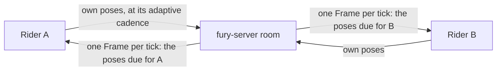

# Game server

Owner decision, 2026-11-13: multiplayer moves from the Cloudflare Durable Object
relay (formerly `crates/atv-relay`) to our own Rust game server, first on one
DigitalOcean droplet in the US (s-1vcpu-1gb, about $6 a month). Hetzner was the
first choice, but its US prices roughly tripled in 2026 (about $20.50 a month for
its cheapest US server), so the owner chose DigitalOcean. There is no fallback to the
Cloudflare relay: once the server is live, clients use it, and the Durable
Object relay is retired. Why: the free Durable Object plan bills every incoming
WebSocket message, so one school's Chromebooks reached the daily limit
(research/MULTIPLAYER.md "What a day like 2026-11-12 would cost"), and direct
WebRTC links fail on networks like theirs.

Clients switched to the server in #611. On 2026-11-14 the relay was removed
entirely (owner: no support, no fallback): its crate, the `make relay` target,
its CI build, the site Worker's `/multiplayer/` proxy, the `LobbyRoom` and
`LobbyAdmission` Durable Objects (deleted by the `retire-relay-v1` migration)
and the room rate limiters. The site keeps only redirects of
`/multiplayer/freeride/riders` and `/days` to this server. `net::GAME_SERVER`
is no longer optional: every page uses it, except a page served from a
loopback origin (the local test proxy, `tools/serve_multiplayer.mjs`) or one
given `?server=<origin>` (desktop: `FURY_SERVER`). Sections below that compare
with "the relay" describe the behavior the server kept from it.

## Shape

The way games with larger lobbies of positional players are usually built: a
star, not a mesh.



- Each rider sends only its own state (compact snapshots and deltas, game
  packets) to the server. No WebRTC links: room claims answer `links: false`.
- Each room runs a fixed tick (20 Hz). Per tick and per recipient, the server
  sends one `Packet::Frame` (kind 21, atv-net) holding the latest pose of every
  other rider that is due for that recipient. Interest management decides what
  is due: near riders every tick, farther riders less often, unchanged riders
  not at all (same distance tiers as the relay's batches). Builds that did not
  say `signal::FRAMES` get each pose separately, as from the relay.
- Clients do not batch on the server (`batches: false`): sends are cheap, and a
  batch adds up to a tier interval of latency.
- Everything else (lobby, host authority over the map, rejoin keys and the
  30-second hold, games, race progress and CPUs, claims, pings with server
  time) keeps the relay's behavior and wire format, so the existing clients and
  browser tests work against the server by pointing them at it.

## Server agnostic

`fury-server` is one static Linux binary with no host-specific code. It runs on
any VPS, in a container, or behind any TLS proxy. Provider-specific scripts live
only under `deploy/digitalocean/`.

| Setting (env) | Meaning | Default |
|---|---|---|
| `FURY_LISTEN` | address:port | `127.0.0.1:8789` (the port `tools/serve_multiplayer.mjs` and the browser tests use) |
| `FURY_ALLOWED_ORIGINS` | comma-separated page origins allowed to open rooms | the production origins plus `http://127.0.0.1:*` when listening on loopback |
| `FURY_TLS` | `off` (plain, behind a proxy or local), `acme` (Let's Encrypt TLS-ALPN-01 in process), `files` | `off` |
| `FURY_ACME_DOMAINS`, `FURY_ACME_EMAIL`, `FURY_ACME_CACHE` | certificate names, contact, cache dir | — |
| `FURY_TLS_CERT`, `FURY_TLS_KEY` | PEM paths for `files` | — |
| `FURY_STATE_DIR` | rooms saved at shutdown and restored at start; daily usage | `./state` |
| `FURY_COMMIT` | build commit shown by `/healthz`, `/multiplayer/version` and `--version`; set at build time it is compiled in, set at run time it overrides | `host-only` |
| `FURY_UNCOUNTED_IPS` | comma-separated client addresses or CIDR blocks (IPv4 or IPv6, e.g. an IPv6 `/64`; matched against the peer, or the `X-Forwarded-For` a loopback proxy sends, as admission does) left out of the public counts: the owner's test machines. Their riders play normally but do not count toward `/healthz` riders, rooms and connections, `/multiplayer/freeride/riders` or the daily `busiest` riders, and a room counts only while it has a counted rider (a room without one adds nothing to the daily usage). `/metrics` keeps the totals (`fury_riders_all`, `fury_rooms_open`, `fury_uncounted_connections`). An invalid entry stops the server at start; settings never log the addresses | — |
| `RUST_LOG` | log filter (JSON logs to stdout) | `info` |

Routes: every relay route under `/multiplayer/` (create/open a private room,
Free Ride claim, room WebSocket, rider count, daily usage, version), plus
`/healthz` (JSON: ok, commit, protocol, uptime, rooms, riders, connections;
counted riders only, see `FURY_UNCOUNTED_IPS`) and
`/metrics` (Prometheus text, loopback only). CORS and Origin checks replace the
same-origin rule the relay had behind the site Worker.

Restarts: on SIGTERM the server stops accepting, saves rooms (codes, slots,
rejoin keys, lobby, host) to `FURY_STATE_DIR`, and closes sockets with 1012.
Clients rejoin with their keys inside the 30-second hold, so a deploy costs a
brief hitch, not a lost room.

## Efficiency

- One task per room (actor), fed by channels; no locks on the message path and
  no per-message storage.
- Each incoming pose is decoded and validated once and kept as encoded bytes;
  frames are assembled from those bytes.
- Per-connection bounded send queue: a slow client loses stale poses first
  and is closed if it stays stuck. Per-connection message and byte rate limits
  as in the relay.
- Admission limits per IP for room creation and connections.
- Capacity is measured with the load tester (`crates/atv-loadtest`), not
  guessed.

## Implementation

`crates/atv-server` (binary `fury-server`), tokio and axum, rustls with ring
(no OpenSSL). Release builds use `opt-level = 3` for this crate only.

- `engine`: one room as a pure state machine, clock and randomness passed
  in, unit-tested. It is the relay's room code with the Durable Object parts
  removed: slots, rejoin keys and the 30 s hold, host promotion, lobby,
  host-only `Game`/`Cpus` (CPU sound cues stripped for builds without
  `signal::CPU_SOUNDS`), `Progress`, `Claim`, pings with server time, the
  per-connection rate limit (360 messages and 3 MiB per 3 s), 60 s idle
  close, 12 h private-room age and the 60 s empty-room expiry. `Signal` other
  than HELLO, `Links` and `Bundle` are accepted and ignored (older clients
  still send them); a `Batch` from an older build is unpacked into its poses.
  No PRESENT/ARRIVED/GONE/COURIER/PACE signals are sent.
- Poses: a `Delta` is applied to the sender's baseline as on the relay; the
  newest accepted pose is kept as encoded bytes (re-encoded only when the
  client stamped another slot). Builds without `FRAMES` get each pose at once
  from those bytes, as from the relay; builds with it get frames. Motorcycle
  poses go only to builds whose HELLO said `MOTORCYCLES`
  (research/MULTIPLAYER.md "Motorcycles").
- `interest`: each 20 Hz tick, per recipient on the room's map, the other
  riders' newest poses that are due, assembled into `Frame`s from bytes
  (split at `MAX_FRAME` poses or `MAX_PACKET_BYTES`):

  | Rider, by distance to the recipient's own newest pose | Sent |
  | --- | --- |
  | under 60 ft | every tick with a new pose |
  | 60-300 ft | every 100 ms |
  | 300-1,000 ft | every 200 ms |
  | beyond 1,000 ft | every 300 ms |
  | at rest (under 0.5 ft/s, riding) | when it moves 0.25 ft, else every 2 s |
  | a change of rider state, a crash, setting off or stopping | at once |

  A pose a recipient already has is never sent again. Full (non-compact)
  snapshots cannot travel in frames and are sent on their own.

  The tiers sit a tick or more under a Free Ride rider's own send intervals
  (`links::freeride_interval`: 150, 300 and 350 ms; about 240 ms measured at
  300-1,000 ft), so a Free Ride pose waits at most for the next tick, because
  receivers play poses back with a delay
  sized for those and drop a moving rider after 1 s without a pose. Measured
  with `test_engine_freeride_relay.mjs` and the
  frames client of #604, the relay-era tiers (200 ms, 500 ms, 2 s) left the
  watcher 3.3 ft rms off at 60-300 ft and 5.9 ft rms (39 ft at worst, frozen
  for 290 ms) at 300-1,000 ft. Thinning further needs receivers that size
  their delay from each rider's arrival interval.

  Even with no thinning at all, the #604 client fails that test's 300-1,000 ft
  checks (195 ms frozen against 150, 16.5 ft at worst against 12; 1.9 ft rms):
  in Free Ride it sends about every 300 ms there and plays poses back about
  240 ms late, so it extrapolates across every gap. That is a client fix
  (playback delay at least the rider's send interval plus a tick); 60-300 ft
  and contact range pass (0.4-0.6 ft rms). Clients since that fix size the
  delay from each rider's measured interval (up to 800 ms gaps, so the
  500 ms tier's 700 ms arrivals too) and pass the 300-1,000 ft checks at
  about 0.4 ft rms with no freeze (research/MULTIPLAYER.md "Slow senders
  and the game server").

  The far tier was 500 ms until 2026-11-14. It passed only every other
  pose of a rider sending every 350 ms, so poses came 700 ms apart and
  watchers beyond 1,000 ft drew the rider frozen: in the same test's mixed
  phase (a rider joins while the driver is far off, then the driver sets
  off), 221-258 ms for both watchers in one run and 310-518 ms for the
  newcomer in an earlier one. It was not a missing delta baseline: like the
  relay, the server applies each `Delta` to the sender's baseline and
  passes on the resulting compact snapshot (kind 9), in catch-up, single
  poses and frames, so a rider that joined later never needs an earlier
  pose. 300 ms passes every far pose (picked up 350 or 400 ms after the
  last) with a tick to spare for network jitter. Measured after the change
  (two runs): the mixed watcher beyond 1,000 ft froze 38 and 155 ms, and
  the shared phase's beyond-1,000 ft watcher 197 and 172 ms (430 ms, 12.2 ft
  rms and 72 ft at worst before; 3.9 and 3.6 ft rms after), with clients
  from before that playback-delay fix, which still played far poses
  back about 240 ms late against a 350 ms send interval. Clients with that
  fix ride out the 700 ms gaps too, but only by drawing far riders about
  twice as late; the 300 ms tier keeps far poses as fresh as they are sent.
- `rooms`: one task per room, fed by a bounded channel; the registry is a
  mutex touched only to open, find, claim or end rooms. `outbox`: each
  connection's send queue holds 256 KiB / 512 packets; when full the oldest
  poses go first, and a queue full of control packets closes the socket with
  1013 (the slot is held). A send that blocks 10 s closes it too.
- `admission`: per client address (the peer, or the last
  `X-Forwarded-For` entry from a loopback proxy), 30 room creations or claims
  then one per 2 s, 120 sockets then two a second, at most 200 open. Loopback
  peers are not limited (local tests, the load tester).
- HTTP: the relay's routes and JSON, with `"links": false, "batches": false,
  "frames": true` in room creations and claims. Everything but the public
  rider count, daily usage, `/healthz` and `/metrics` needs an allowed
  Origin and answers CORS for it (preflights included). The desktop app
  presents the server's own origin, so `https://mp.furyremastered.com` is in
  the default list. `/multiplayer/freeride/riders` and `/days` keep the
  relay's shape (pose kinds, with `senderOld`/`senderNoLinks` meaning a pose
  from a build with or without HELLO) and add `frames`; usage is kept in
  `FURY_STATE_DIR/usage.json`.
- `fury-server --version` prints `fury-server <version> <commit> protocol <n>`
  and exits 0 without starting the server or touching the state directory
  (the deploy script and CI use it). Any other argument is refused.
- Restarts: SIGTERM or SIGINT stops accepting, saves every room to
  `FURY_STATE_DIR/rooms.json` (connected riders become held slots), closes
  sockets with 1012 and exits within about 6 s. At start the file is read
  once and removed; its riders are held for 30 s from the restart. A file
  older than two minutes is ignored.

## Running it

- Locally: `make server` builds it, `make server-run` serves it on 8789; the
  multiplayer browser tests run against it through `tools/serve_multiplayer.mjs`.
- Production: `deploy/` holds a cloud-init file, a hardened systemd unit
  (`Restart=always`, its own user, `CAP_NET_BIND_SERVICE` for 443), a
  provisioning script and a deploy script (upload, switch, health-check,
  roll back). The server host rebuilds from the repository with one command.
  Since online identity (research/ONLINE_IDENTITY.md) it keeps one thing
  worth a backup: `FURY_STATE_DIR/players.json` (riders, friends, stats,
  league); that note has the backup proposal.
- CI builds and tests the server on every change to it; on main it deploys when
  the deploy secrets exist.
- A Cloudflare cron (free) checks `/healthz` every five minutes and records it;
  `/status/game-server` reports the latest check and uptime.

Hostname: `mp.furyremastered.com`, a DNS-only record to the droplet's reserved IP (TLS from
Let's Encrypt in the server, so WebTransport can share the certificate later).

## Later

WebTransport datagrams with WebSocket kept for networks that block UDP; per
recipient delta compression in frames; larger lobbies (the protocol caps a
room at 20 riders today); a second region; server-checked race results.

## Load testing

`fury-loadtest` (`crates/atv-loadtest`) simulates riders against any server
that speaks these routes: a local fury-server or (only with the owner's
go-ahead) production. Each rider claims a Free Ride slot or a private
room over HTTP, joins over the room WebSocket, says the hello the game would
(FRAMES when the claim says `frames`), and sends compact snapshots and deltas
along a loop: 20 Hz while moving near others (`--clustered` riders ride in
groups of six), 10 Hz while moving far apart, 1 Hz at rest. It pings for round
trips and counts what comes back. Counters cover the window after ramp-up.

```sh
cargo run --release -p atv-loadtest -- --url http://127.0.0.1:8789 \
  --origin http://127.0.0.1:4187 --riders 200 --duration 60 --ramp 10 --out load.json
```

`--rooms N` puts the riders in N private rooms (four at most each; the first N
riders host) instead of Free Ride; `--frames auto|on|off` (default `auto`),
`--ping-ms`, `--seed`. `--origin` presents a page origin the server allows
(or point `--url` at `tools/serve_multiplayer.mjs` on 4187). The
JSON report has connections ok/failed/live/disconnects, messages and bytes in
and out per second, poses received per rider per second (single, batched,
bundled or framed), frames per second, round-trip p50/p95/p99, and close or
failure reasons. Thousands of riders need a raised open-file limit
(`ulimit -n`) on the load machine; run it from another host than the server
for capacity numbers.
