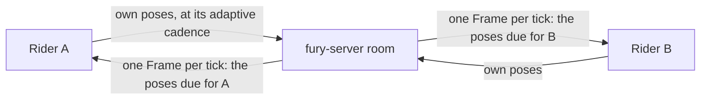

# Game server

Owner decision, 2026-11-13: multiplayer moves from the Cloudflare Durable Object
relay (`crates/atv-relay`) to our own Rust game server, first on one
DigitalOcean droplet in the US (s-1vcpu-1gb, about $6 a month). Hetzner was the
first choice, but its US prices roughly tripled in 2026 (about $20.50 a month for
its cheapest US server), so the owner chose DigitalOcean. There is no fallback to the
Cloudflare relay: once the server is live, clients use it, and the Durable
Object relay is retired. Why: the free Durable Object plan bills every incoming
WebSocket message, so one school's Chromebooks reached the daily limit
(research/MULTIPLAYER.md "What a day like 2026-11-12 would cost"), and direct
WebRTC links fail on networks like theirs.

## Shape

The way games with larger lobbies of positional players are usually built: a
star, not a mesh.



- Each rider sends only its own state (compact snapshots and deltas, game
  packets) to the server. No WebRTC links: room claims answer `links: false`.
- Each room runs a fixed tick (20 Hz). Per tick and per recipient, the server
  sends one `Packet::Frame` (kind 21, atv-net) holding the latest pose of every
  other rider that is due for that recipient. Interest management decides what
  is due: near riders every tick, farther riders less often, unchanged riders
  not at all (same distance tiers as the relay's batches). Builds that did not
  say `signal::FRAMES` get each pose separately, as from the relay.
- Clients do not batch on the server (`batches: false`): sends are cheap, and a
  batch adds up to a tier interval of latency.
- Everything else (lobby, host authority over the map, rejoin keys and the
  30-second hold, games, race progress and CPUs, claims, pings with server
  time) keeps the relay's behavior and wire format, so the existing clients and
  browser tests work against the server by pointing them at it.

## Server agnostic

`fury-server` is one static Linux binary with no host-specific code. It runs on
any VPS, in a container, or behind any TLS proxy. Provider-specific scripts live
only under `deploy/digitalocean/`.

| Setting (env) | Meaning | Default |
|---|---|---|
| `FURY_LISTEN` | address:port | `127.0.0.1:8789` (the local relay port the browser tests use) |
| `FURY_ALLOWED_ORIGINS` | comma-separated page origins allowed to open rooms | the production origins plus `http://127.0.0.1:*` when listening on loopback |
| `FURY_TLS` | `off` (plain, behind a proxy or local), `acme` (Let's Encrypt TLS-ALPN-01 in process), `files` | `off` |
| `FURY_ACME_DOMAINS`, `FURY_ACME_EMAIL`, `FURY_ACME_CACHE` | certificate names, contact, cache dir | — |
| `FURY_TLS_CERT`, `FURY_TLS_KEY` | PEM paths for `files` | — |
| `FURY_STATE_DIR` | rooms saved at shutdown and restored at start; daily usage | `./state` |
| `FURY_COMMIT` | build commit shown by `/healthz` and `/multiplayer/version` | `host-only` |
| `RUST_LOG` | log filter (JSON logs to stdout) | `info` |

Routes: every relay route under `/multiplayer/` (create/open a private room,
Free Ride claim, room WebSocket, rider count, daily usage, version), plus
`/healthz` (JSON: ok, commit, protocol, uptime, rooms, riders, connections) and
`/metrics` (Prometheus text, loopback only). CORS and Origin checks replace the
same-origin rule the relay had behind the site Worker.

Restarts: on SIGTERM the server stops accepting, saves rooms (codes, slots,
rejoin keys, lobby, host) to `FURY_STATE_DIR`, and closes sockets with 1012.
Clients rejoin with their keys inside the 30-second hold, so a deploy costs a
brief hitch, not a lost room.

## Efficiency

- One task per room (actor), fed by channels; no locks on the message path and
  no per-message storage.
- Each incoming pose is decoded and validated once and kept as encoded bytes;
  frames are assembled from those bytes.
- Per-connection bounded send queue: a slow client loses stale poses first
  and is closed if it stays stuck. Per-connection message and byte rate limits
  as in the relay.
- Admission limits per IP for room creation and connections.
- Capacity is measured with the load tester (`crates/atv-loadtest`), not
  guessed.

## Running it

- Locally: `make server` builds it, `make server-run` serves it on 8789; the
  multiplayer browser tests run against it through `tools/serve_multiplayer.mjs`.
- Production: `deploy/` holds a cloud-init file, a hardened systemd unit
  (`Restart=always`, its own user, `CAP_NET_BIND_SERVICE` for 443), a
  provisioning script and a deploy script (upload, switch, health-check,
  roll back). The server host rebuilds from the repository with one command; it
  keeps nothing that needs a backup.
- CI builds and tests the server on every change to it; on main it deploys when
  the deploy secrets exist.
- A Cloudflare cron (free) checks `/healthz` every five minutes and records it;
  `/status/game-server` reports the latest check and uptime.

Hostname: `mp.furyremastered.com`, a DNS-only record to the droplet's reserved IP (TLS from
Let's Encrypt in the server, so WebTransport can share the certificate later).

## Later

WebTransport datagrams with WebSocket kept for networks that block UDP; per
recipient delta compression in frames; larger lobbies (the protocol caps a
room at 20 riders today); a second region; server-checked race results.

## Load testing

`fury-loadtest` (`crates/atv-loadtest`) simulates riders against any server
that speaks the relay's routes: the local relay, fury-server, or (only with the
owner's go-ahead) production. Each rider claims a Free Ride slot or a private
room over HTTP, joins over the room WebSocket, says the hello the game would
(FRAMES when the claim says `frames`), and sends compact snapshots and deltas
along a loop: 20 Hz while moving near others (`--clustered` riders ride in
groups of six), 10 Hz while moving far apart, 1 Hz at rest. It pings for round
trips and counts what comes back. Counters cover the window after ramp-up.

```sh
cargo run --release -p atv-loadtest -- --url http://127.0.0.1:8789 \
  --origin http://127.0.0.1:4187 --riders 200 --duration 60 --ramp 10 --out load.json
```

`--rooms N` puts the riders in N private rooms (four at most each; the first N
riders host) instead of Free Ride; `--frames auto|on|off` (default `auto`),
`--ping-ms`, `--seed`. The local relay admits only its `GAME_ORIGIN`, hence
`--origin` (or point `--url` at `tools/serve_multiplayer.mjs` on 4187). The
JSON report has connections ok/failed/live/disconnects, messages and bytes in
and out per second, poses received per rider per second (single, batched,
bundled or framed), frames per second, round-trip p50/p95/p99, and close or
failure reasons. Thousands of riders need a raised open-file limit
(`ulimit -n`) on the load machine; run it from another host than the server
for capacity numbers.
