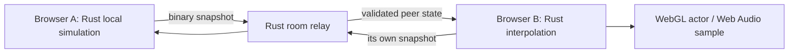

# Rust browser multiplayer implementation

This is an authored four-player Freeride baseline, building on the original
four-player/host-controlled experience documented in [original research](MULTIPLAYER_ORIGINAL.md).
It does not execute PS2 network code or emulate the disc executable.

## Authority and latency

Each player simulates their own quad in Rust at the established local cadence;
controls do not wait for a network round trip. The current host owns the room's
map. A Rust Cloudflare Durable Object authenticates each rider's private slot key,
assigns participant slots, validates shared binary packets and relays snapshots.
The room code and invite URL contain no credential. A dropped rider's slot is held
for 30 seconds while the browser retries its key for up to 25 seconds, preserving
the loaded ride; the same tab also recovers its slot after a reload. When the host
leaves, map authority passes to another rider and the ride continues (see the
drop-in section below). Competitive authority is not implemented. Authored
yawed-box contacts let each owner apply only its own response. This is not the
original PS2 contact behavior, and the relay does not reconcile physics. Packet
schema changes are incompatible with earlier clients; clients must reload before
joining a room on a newer version.

Protocol v3 sends compact full snapshots and changed-block deltas rather than
source node matrices. A full snapshot is 135 bytes; adding a moving-platform
transform adds 20 bytes, and a no-change baseline patch is 26 bytes. Position
remains exact binary32; orientation, velocities and animation weights are
quantized, with an exact binary32 escape for valid values outside a quantized
field's range. Production uses message kinds 9 (compact full snapshot) and 10
(baseline delta); kind 4 remains a legacy full-pose format for codec and relay
regression fixtures. When a changed-block patch would save no bytes, including
when all four blocks change, the sender chooses an independent full snapshot of
the same size to avoid relay baseline reconstruction; partial patches remain in
use. Delta baselines advance only after an actual send receipt. The relay caches
canonical compact states in room attachments for late joins and encodes each
broadcast once. It does not store pose updates in SQL. Solo rooms send no
movement poses.

Cadence adapts to motion and distance: up to 20 Hz for near, fast, airborne or
wrecked riders; 10 Hz for ordinary movement; 5 Hz beyond 300 feet; and 1 Hz while
stationary. Near means under 40 feet; fast means over 35 feet/second. Actual
browser suspension uses 0.2 Hz presence updates and host train synchronization
uses 2 Hz. The online Pause menu keeps neutral-input physics running; opening it
does not count as browser suspension. Presence remains fresh during actual
suspension, with one-second moving, 2.5-second stationary, and 15-second
suspended freshness windows; the existing train freeze behavior is retained in
actual suspension. Unchanged state is suppressed, and resume/state changes
trigger prompt delivery.

Receiving Rust samples the recovered ATV linkage and rider animation recipes
locally. Remote Air/Bounce crash clips run on independent local clocks while the
detached rider root, velocity, crash and recovery states replicate. This reduces
transport pose data while retaining local crash motion, but does not establish
source animation-blend equivalence. Rust interpolation keeps shortest-arc
quaternions, an 80ms presentation buffer, a 100ms extrapolation cap, and a
one-second stale marker. State changes, large teleports, actor changes, slot
reuse and lobby epochs reset interpolation. The delay smooths remote motion but
cannot remove Internet latency; WebSockets retain TCP head-of-line blocking.
Host/server physics reconciliation and datagram/WebRTC transport remain open.

Counters report bytes, packet/full/delta/suppressed counts and WASM operation
time separately from JavaScript round-trip time. An October 13 host-only run
sent 133 packets / 17,901 bytes during 10.0114 seconds of driving (13.2849 Hz),
with 135- and 117-byte packets. Payload bytes were 94.6717% below a same-count
2,526-byte male v2 baseline. Each suspended client sent two 135-byte presence
updates over 11.0119 and 11.0137 seconds and remained fresh; late join placed the
guest at exactly zero feet from the host root, and a 5.5103-second solo interval
sent zero pose packets.
See [measured implementation and limits](MULTIPLAYER_EFFICIENCY.md). This is
host-only evidence, not a production timing, bandwidth-bill, or public-release
claim. Protocol v3 is incompatible with old tabs; reload before joining a v3
room. JavaScript remains socket, DOM/WebGL and Web Audio API glue.

## Create and join flow

The Multiplayer menu offers **Host Game** and **Join Game**, using the original
executable's own lobby strings. Both forms collect a remembered rider name and
offer the garage. Host Game continues to **Select Track** (the original course
picker); its Ride creates the room and starts riding at once, so there is no
pre-ride lobby wait. Create accepts an optional custom code of exactly eight
letters or digits; a blank code requests a random one. Join requires an
eight-character code. Invite links join the live room directly, or reopen that
code on the link's map after the room has ended (see the drop-in section below).

## Models and sound

The garage exposes all 26 original in-race quads with their own PHY, AO/AR collision,
mechanical linkage and material resources, plus the male/female mesh and matching
78-motion catalogs. This is a browser selection adaptation; original unlock/profile
rules are not reconstructed. Exact 25 labels and unlisted ATV06 are documented in
[model evidence](MULTIPLAYER_MODELS.md). The existing port's default ATV01 is retained.

Remote actors use separate GPU geometry/texture ownership and locally reconstructed
node poses, including the detached rider's independently replicated world root
during a wreck. Inactive model caches evict their bounded Rust/GPU state and rig
revision changes invalidate old poses. Audio
uses the selected original per-quad engine banks and recovered spatial arithmetic
for distance, stereo pan and Doppler. Rust selects samples; Web Audio transports
local PCM. Crash serials drive original body-impact samples at the rider position.
While a multiplayer ride is visible, opening the online Pause menu or losing
focus clears local drive input and continues neutral-input simulation, so peers
receive the moving rider state. Actual hidden-tab/context suspension uses low-rate
presence updates and freezes the shared train clock; it does not suspend into a
pose-stale state. Stale/left peers lose voices. Per-rider vocal
fidelity, original multiplayer mixer budget, clothing
presets and original PS2 rendering/animation parity remain unverified. Host-only
efficiency measurements and pending gates are recorded in
[MULTIPLAYER_EFFICIENCY.md](MULTIPLAYER_EFFICIENCY.md).

## Original player indicator evidence

The exact USA v2.00 executable's compass initializer at `0x002e68e0`
loads `CompassBkg` and `CompassArrow`, selects the current actor by participant
index, and iterates the actor list to create indicators for other actors. Its
source tint values map participant slots 0–3 to red, blue, green and yellow
(`0xff0000`, `0x0000ff`, `0x00ff00`, `0xffff00`). The original
`textures/compassarrow.pst` is an 8×8 white, alpha-masked arrow pointing up in
its stored orientation; `textures/compassbkg.pst` is a 128×128 compass face.
Both are present in the extracted ENV01 Freeride archive. A decoded, inspected
preview is kept in ignored `work/verification/compassarrow.png`.

This supports the original participant color mapping and compass indicator
art. It does not establish an original overhead marker or nametag. Any browser
marker drawn above remote riders uses authored placement and presentation; it
should be described as such rather than as recovered PS2 placement behavior.

## Host-only multiplayer feature gate

On 2026-10-13, a local two-client browser run admitted a guest more than six
seconds after Arlington Freeride had started, using the same room code; each
client rendered 13 remote draws. The minimap and original compass arrows updated,
and the paused Players screen offered the late guest a nearby-host spawn action.
At 390×844 its measured hitbox was 342×64 pixels at `(24,96)`. The inspected
captures are recorded in the dev log. The follow-up integrated run again passed
late admission and spawn; owner-local contact counters reached 6 and 2. A
20-sample moving flatbed check kept the rider within 0.80435 ft of the
train-relative position. Host departure cleaned up the guests.

Peer indicators now follow remote rider world poses and share the minimap's `-X`
orientation and zoom mapping. The projection gate covered quad 1 on ENV02 with
41 moving and 7 tracking samples and quad 26 on ENV01 with 50 moving and 7
tracking samples; all reported no errors. A four-browser host run selected quads
1, 14, 26 and 2. Each client rendered 39 remote GL draws and three remote engine
voices. Each driver's motion reached the other three observers; host departure
cleared remote models and audio on every guest. The relay gate passed 13 live
cases. The integrated workspace passed 403 Rust tests, 91 JavaScript tests (102
including Worker tests), formatting, strict Clippy, Worker checks, setup and
repository hygiene. The release suite passed 34 tests with one skipped.

These are host checks only. They do not establish public release, physical-phone
input, geographically separated latency, authoritative collision or server-side
physics reconciliation. The equal-mass six-foot swept-cylinder contacts and
overhead player labels are authored browser behavior; the recovered original
compass art and slot colors do not establish original overhead placement. The
shared train animation clock currently freezes when its host pauses. The
integrated main tree was checked against `origin/main` 106e937; public delivery
is pending.

## Verification and deployment

Pure protocol tests use synthetic malformed/bounded packets and clock/sequence
rollover, quaternion/shear reconstruction, discontinuities and stale handling.
Native private-resource probes cover all 26 quads and both rigs’ 3,276 sampled poses.
Rust adapter tests cover roster/model authority, pose lifetime and silent rendering.
Browser bridge tests cover asynchronous session isolation, backpressure, cleanup,
pause and audio lifecycle. Opt-in `tools/test_multiplayer_relay.mjs` exercises the
Rust service with the Rust codec; `tools/test_multiplayer.mjs` exercises actual
WASM/content, two-player link admission, different rigs, movement and departure.
`ATV_MP_WRECK=1` adds a real-touch failed-stunt/detached-rider/recovery check.

GitHub CI packages the authored frontend and compiled Rust relay as one checked
artifact, then deploys both through the existing game Worker. Its deployment entry delegates
room routes to the compiled Rust module and exports the Rust Durable Object. Original
resources and screenshots remain in a separately validated R2-only manifest; the
expanded package is lazy for other quad archives. `/multiplayer/version` identifies
the checked relay commit/WASM hash through configuration, while public browser
checks verify actual socket/game operation. Host checks are not a public release.

## Public integration evidence

Main `ceee73d44bc69f940729c5fdf20b892e4394bb59` and CI `38300517282` are
verified through the production HTTPS app. The relay's identity and all authored
static/R2 object hashes match their checked packages. Eleven live public room
gates cover capacity, authentication/identity, packet validation, rate limits and
cleanup. A real copied-invite two-client session replicates movement, original
spatial engine/impact audio, 390px touch-driven crash, detached rider and recovery.
An actual four-browser session gives each client three remote actors/engine voices
and propagates each rider's movement to all observers; host-end clears every guest.
All 26 garage choices also drive through actual public UI with alternating rigs.

Opt-in browser gates are `tools/test_multiplayer.mjs`,
`tools/test_multiplayer_four.mjs` and `tools/test_player_models.mjs`; original game
content is supplied only by the separate approved manifest or private host server,
never CI. The four-client timing sample uses one Mac, Chromium Metal, 1280×896 and
synthetic focus: 71.59–74.14 FPS, 2.47–2.92ms render CPU, 2.1–4.3ms physics worker
round trips and 37–201ms relay RTT (final 42–47ms). Headless/backend/device/workload
and location matter; these numbers do not establish performance on other devices.
See `DEPLOYMENT.md` and the public dev log for broader checks and limitations.

## Ninth-map integration

Vancouver Ridge (`FREE05`) joins the stable Rust catalog as map ID 9, after
`env01`–`env08`. The Rust protocol/relay share that catalog and reject ID 10;
the WASM adapter derives environment keys and next-map choices for the browser.
This extends supported values without changing packet layout. Public main
`cef26f4495f0c5dbf6f8398133ea81bf4b78aed3` / CI `38307658534` passes actual
copied-link two-browser Vancouver driving/audio/cleanup plus 13 live relay cases,
including all-four map selection and invalid-map rejection. Host closure during
asset loading keeps the completed old load on Multiplayer without reviving its
room or resuming a disconnected ride. All authored files, the Rust relay hash and
402 served objects match checked packages through HTTPS.

The merged renderer also passes four actual public clients, each with three
finite remote actors, 39 remote draws and three engine voices. All four drivers'
movement reaches every observer; host-end clears guest rooms and pose/audio/GPU
caches. A real 390px touch failed stunt records 403 guest frames across riding,
airborne and wreck, including 42 detached-rider frames and 14 impact-audio frames
with changing pan, then recovery. The four-client 12-second sample on one Mac,
headless Chromium Metal, 1280×896 and synthetic focus is 71.00–75.86 FPS,
25.9–27.2ms frame p95, 2.61–3.11ms render CPU, 2.1–6.6ms physics round trip and
41–52ms relay RTT. Concurrent validation workload was not measured; this is not
a general device or Internet performance claim.

Historical note: at the public integration checkpoint above, shared dynamic-world
clocks and server/host physics reconciliation remained future work; that release
relayed rider-owned simulations while scene animations and dynamic objects ran on
each client's local clock. Later host-only checks now cover synchronized train
timing and authored player contacts, but the shared train clock still freezes
when its host pauses. These changes passed public verification at 551d7fd; see the follow-up below. Competitive
authority, host migration and original online/race rules remain unfinished.

## Public late join, visibility and contact follow-up (2026-10-13)

Main `551d7fd890946f18cc8ef8430c12f843138fe758` passed CI
[38446510103](https://github.com/nrgapple/atv-offroad-fury-2-web/actions/runs/38446510103)
and is verified on both `https://furyremastered.com/` and the
[Workers production app](https://atv-offroad-fury-2.champtoday.workers.dev/). The
validated artifact and `/deployment.json` identify that commit. Full HTTPS checks
match 39 authored/static files and 446 served objects. The approved R2 package has
447 objects totaling 338,648,873 bytes; three changes uploaded the larger-label
host capture, Players capture and gallery. The gallery snapshot contains 160 log
entries and 131 screenshots before this text-only verification entry.

The public two-client route preserves custom code `FV70MYWD`, admits a late rider
after the ride starts, and renders 13 remote draws on both clients. Paused Players
spawn has a 342×64 target at (24,96), placing the guest about 10 feet from the
host. Owner-local contact counts reached 5 and 3; across 20 moving-flatbed samples,
maximum train-relative error was 1.29715 feet. Host departure cleaned up guests.
Fourteen public relay cases pass, including custom and duplicate codes. The relay
WASM SHA-256 is
`8776744065b1b42d6ac9faf13034c0c39d7246202ea3476646400b622b634753`.

The public four-browser run selected quads 1, 14, 26 and 2. Each client rendered
39 remote draws and three engine voices; each rider's movement reached all
observers, and host end cleared guest rooms, models and audio without HTTP or page
errors. These automated routes do not establish physical-phone behavior or
geographically distributed latency. The train clock freezes while its host is
paused; local contacts have no server reconciliation. Racing, competitive
authority, host migration and full original-game parity remain unfinished.

## Host recovery and retained diagnostics (2026-10-13)

Closed Durable Object room records previously rejected recreation forever, and
any host socket departure immediately ended the room. Generation-aware recreation
and the recovery window above address both failure paths. Host replacement sends
a Leave/reset before the new roster, clearing observers' old pose sequence buffers.
Explicit leave and protocol/rate violations still close the room immediately.
Surplus incoming poses above 48 queued messages are discarded, preserving 16 slots
for control traffic within the 64-message bound; a resume burst no longer closes a
healthy session solely for too many old snapshots.

Workers Logs now retain structured lifecycle events: room creation/closure,
connection rejection, peer join, host recovery grace, close requests and actual
close events, including code, reason, elapsed idle time and rate counters. Custom
logs exclude names, capabilities, packet bodies and raw URLs. Invocation logs are
disabled. Browser diagnostics retain the most recent close code/reason, visibility
and queue depth in `atv-last-disconnect` session storage and terrain status.
The original user disconnect cause remains unproven; the prior deployment had no
retained lifecycle diagnostics. This is host-tested implementation pending CI and
public verification, not a claim that all network interruptions can be prevented.

Public main `f1f561a` (CI38451585696) passed the actual browser recovery and owner
reload gate, including 20 train samples after landing propagation (2.337ft maximum
relative error). Public relay diagnostics exposed a Cloudflare callback returning
1006 after a server-requested policy close1008; socket metadata now preserves the
original recovery decision. Query strings are redacted from platform request
metadata as well as omitted from custom logs. This follow-up passed 16 host relay
gates and awaits public verification at this checkpoint.

## Host-only efficiency gate (2026-10-13)

The v3 compact/delta codec, adaptive cadence, idle suppression, locally sampled
ATV/rider animation, and relay/cache efficiencies pass the host implementation
checks. The final host feature/train/reconnect gate passed: late join retained a
custom code; recovery after close 1012 and owner reload succeeded; nearby spawn
and the 342×64 mobile target were present; owner-local contact counts reached 9
and 40; both head-on crashes notified peers; and cleanup passed. Across 20 train
samples, maximum relative position error was 0.737246 feet. The final-build
measured probe and four-client rerun passed. Each client recorded 39 GPU draws
for three remote actors and three engine voices; movement reached all observers
and host end cleared all clients with no HTTP or page errors. The 12-second
same-host timing sample recorded 71.82–73.76 FPS, 27.0–27.2 ms frame p95,
2.03–2.30 ms render CPU, 2.0–3.2 ms physics round trip, and 1–5 ms relay round
trip. These timings do not represent geographic latency. The frontend regression
passed the original title/menu, controller, Tioga, portrait Caribou load, pause,
and Controls routes without a file picker or page errors. All host gates now
pass; current-main CI and public verification remain pending.
See [efficiency evidence and limits](MULTIPLAYER_EFFICIENCY.md).

## Public protocol-v3 multiplayer efficiency verification (2026-10-13)

Main `8c0ace5b8c46a91bf2a50d49bd192a639d23b38b` passed CI/deploy run
[38464469566](https://github.com/nrgapple/atv-offroad-fury-2-web/actions/runs/38464469566)
and public verification at `furyremastered.com` and the workers.dev app. The
Workers verifier matched 42 static files and 452 served R2 objects; the public
gallery contains 173 entries and 137 screenshots.

The public protocol-v3 probe sent 142 packets / 19,134 bytes in 10.0125 seconds
(14.18227 Hz), with 135- and 117-byte packets. This is 94.6656% fewer payload
bytes than a same-count 2,526-byte male v2 baseline. Two synthetic suspended
clients each sent two 135-byte updates in about 11.02 seconds and remained fresh;
late join restored the root at zero positional error, resume passed, and a
5.5091-second solo interval sent no poses. Full and route details are in
[multiplayer efficiency evidence](MULTIPLAYER_EFFICIENCY.md).

Four public browsers using quads 1/14/26/2 each rendered three remote actors in
39 GPU draws and played three engine voices. Every driver was seen moving by all
observers; host end cleared remote state with no HTTP or page errors. Public
feature checks also passed custom-code late admission, minimap labels, close-1012
recovery with train time preserved, nearby spawn and its 342×64 mobile target,
owner contacts [2, 10], both head-on wreck notifications, owner reload, and
cleanup. Twenty train samples stayed within 0.8996261966 feet of deck-relative
position.

The recorded four-client timing is from one Mac and is not a geographic-latency
or physical-phone result. These bounded multiplayer routes do not establish
whole-game PS2 parity, authoritative contacts, racing rules, or host migration.

A separate copied-invite public run with male/female models 1/2 passed movement
and host-departure cleanup with 13 draws per client and no page errors. A real
touch failed airborne Nac Nac produced 117 trace frames, including 51 detached
rider frames and 14 impact-audio frames; crash serial advanced 0→1, spatial pan
changed, and remote automatic recovery returned the rider to Riding. See
`work/verification/efficiency-public-wreck.log`.

## Drop-in rooms, smoother riders and box contacts (host checkpoint, 2026-10-14)

Multiplayer now targets friends hopping into a map together at any time.

- **Protocol v4** (`crates/atv-net`): Welcome carries each rider's private
  16-byte rejoin key. `Profile` changes vehicle/rider in place. `Ready{map}`
  reports a loaded map. Pong carries the relay wall clock. v3 tabs are asked to
  reload.
- **Relay** (`crates/atv-relay`):
  - Anyone may join a live room without the host connected.
  - A dropped rider's slot, color and roster entry are held for 30 seconds,
    reclaimable with its key (the creator's capability is slot 0's key).
  - When the host leaves, map authority passes to the lowest remaining rider.
  - The host may change the map while riding, and poses are relayed only from
    riders whose Ready matches the current map.
  - Rooms close after 60 seconds empty. `POST /multiplayer/rooms` with
    `{"code","open":true}` joins a live code or recreates an ended one, under
    the existing create guards.
  - A delta that races a map or vehicle change waits for the sender's next full
    snapshot instead of closing the socket.
- **Client:**
  - Rooms start riding immediately.
  - Arrivals appear beside a rider already present, using the existing safe
    spawn search.
  - Contacts are ignored for 2.5 seconds after any arrival so riders can
    separate.
  - Every rider reconnects with its key.
  - Pause → Change ATV and Rider reloads in place at the current position.
  - The host's Pause → Select Track moves everyone.
  - Joins and host handoff no longer clear other riders' interpolation history.
    Earlier, every epoch change reset all remote buffers.
- **Shared train clock:** the Arlington train phase now derives from the relay
  clock, so it keeps running for everyone when the host pauses, suspends or
  leaves.
- **Smoothing:** `PoseBuffer::present` adds an adaptive jitter buffer, Hermite
  jump arcs, decaying corrections and proximity-aware presentation. In the
  crate's 10 Hz ±30 ms jitter test, the worst 16 ms step error falls from
  0.445 ft (fixed 80 ms delay) to 0.106 ft.
- **Contacts** (`atv-core::peer_contact`):
  - Riders are yawed 4.0 × 6.4 ft boxes, 4.8 ft tall, tested with 3D SAT and
    swept in steps of 1 ft or less.
  - Responses use equal-mass impulses (restitution 0.25), light friction, yaw
    spin from off-center hits (capped at 4 rad/s) and a bounce when landing on
    another rider.
  - The recovered wreck classifier still decides ejection.
  - This is authored behavior, not recovered PS2 multiplayer contact.
- **Presentation:** overhead markers show only the rider's name. Online pause
  rows use the executable's "Change ATV and Rider", "Leave Game" and "Copy
  invite link" wording. Select Track is a browser label for the original course
  picker.

Host verification on the local Rust relay, actual WASM and original content
(Chromium/Metal, one Mac):

- `tools/test_multiplayer_dropin.mjs` passes:
  - hosting from the menus straight into a ride;
  - an invite-link guest meeting 10.3 ft from the host;
  - 134 ft of remote motion;
  - an in-place ATV change to model 15 seen by the host;
  - a host track change from env01 to env02 with both riders reloading;
  - a guest reload reclaiming slot 1;
  - host departure handing the room to the guest, who keeps riding and gets
    Select Track;
  - a 390 px late joiner on the original link;
  - reopening the expired code on env05 from the same link.
- `tools/test_multiplayer_features.mjs` (updated to the new menus) passes:
  - late admission on Arlington with train phases 85.82 / 85.8205;
  - socket-close recovery;
  - spawn beside the host;
  - overlapping box contacts [42, 9] separating past 3.9 ft;
  - 20 flatbed samples within 0.374 ft of deck-relative position;
  - front-first head-on wrecks replicated to both observers;
  - owner reload back into slot 0;
  - handoff on host leave.

Workspace Rust tests, strict Clippy, formatting and the JavaScript suites pass.
These are host checks, not public deployment, physical-phone or geographically
separated latency evidence.

## Arlington Free Ride (host checkpoint, 2026-10-16)

The main menu has an **Arlington Free Ride** item between Multiplayer and
Settings. It has no setup screen: one tap joins a shared room that is already
riding Arlington Stream (`env08`). This is an authored browser mode, not an
original-game online mode.

- **Shared rooms.** `POST /multiplayer/freeride` checks shared rooms
  `FREERD01`–`FREERD25` in order and reserves a slot in the first one with
  space. Each room's Durable Object reserves the slot itself, so two riders
  arriving at once cannot overfill it. The browser connects with the returned
  slot key through the normal room route. Rider 21 opens `FREERD02`; later
  arrivals fill the lowest-numbered room with space, so riders gather together.
- **Room rules.**
  - A shared room holds 20 riders; private rooms keep the original four.
  - The map is fixed and nobody gets host controls: the relay ignores map
    changes.
  - There is no invite link and no 12-hour age limit.
  - The room still closes 60 seconds after it empties, so idle hours cost
    nothing. "Always open" means always joinable.
  - Shared-room codes are reserved; they cannot be hosted or reopened as
    private rooms.
- **Admission.** The Worker admits claims like a room connect: the per-IP
  connect limiter and the global connect budget apply. Claims take no
  room-creation lease, because the 25 shared rooms are a fixed set.
- **Names.** The remembered rider name is used. The default `Rider` becomes
  `Rider ####` so strangers can tell riders apart. In shared rooms the relay
  replaces any name caught by a very simple word filter
  (`atv_net::public_name`) with `Rider <slot>`. Motorcycles fall back to ATV01,
  as in Multiplayer.
- **Protocol v6.** Slots go up to 20. The lobby's started byte becomes a flags
  byte (bit 0 started, bit 1 shared room); the peer bitmask is 32-bit.
  Protocol v5 tabs are asked to reload.
- **Browser changes for 20 riders:**
  - Relay messages queued during a worker decode are packed into one batch
    (adapter op 118) with one status reply. Before this, a full room's ~380
    messages/s overflowed the per-message queue and dropped about 1,600 pose
    updates in 10 seconds.
  - Only the nearest six riders keep a remote engine voice.
  - At most eight name tags are shown, of which at most three are off-screen
    arrows.
  - Slots 4–19 use authored colors after the original red, blue, green and
    yellow.
  - The remote rig and GPU model caches hold one model per possible rider (20)
    instead of eight.
  - The Players page uses columns when 20 rows do not fit above Back.
  - Arrivals spawn beside a random rider rather than slot 0.

Host evidence (one Mac, Chromium/Metal headless, local `wrangler dev` relay,
original content, 2026-10-16) from `tools/test_freeride.mjs`. Two real
browsers (1280×896 and 390×844) and 18 synthetic riders using the Rust codec
over Node WebSockets, at the 20 Hz near/fast cadence, each on a different
quad/rider model:

- Both browsers presented all 19 other riders, with 0 dropped pose updates and
  247 remote GPU draws (13 per rider).
- 70–85 FPS across runs, 25.8–27.1 ms frame p95 and 1.1–1.7 ms render CPU.
- 1–89 ms relay round trip, with at most six engine voices and eight name tags.
- The filtered name was shown as `Rider 3`, the 21st claim opened `FREERD02`,
  and Leave returned to the main menu.

A relay-only load run with 20 synthetic riders at 20 Hz handled 380–400
inbound and about 7,600 outbound messages a second, with a 0.4–13 ms ping
round trip. A joined rider that stopped reading its socket did not stall the
relay.

Twice during early runs, before receive batching, the local `wrangler dev`
process stopped answering every route, including `/multiplayer/version`, at
0% CPU. It did not recur in later full-room runs. This is unexplained
local-tooling behaviour, not a production observation.

Production Durable Object CPU at full-room fan-out, physical phones and
geographically separated latency have not been measured. Synthetic riders
circle at a fixed height, so some sit under the terrain in screenshots.

### Free Ride menu count, NEW tag and direct loading (host checkpoint, 2026-10-16)

- **Direct loading.** Tapping Arlington Free Ride opens the Arlington loading
  screen at once and stays there while the slot is claimed and the ride
  starts. Earlier, the private-room lobby page flashed first.
- **Live rider count.** The menu row has a NEW tag and a live "N riding"
  count, refreshed every 15 seconds while the main menu is open. On phones
  narrower than 380 px, the tag and count wrap onto a second line.
  - Each shared room reports its rider count (connected plus reconnecting
    riders) to one counter Durable Object (`freeride-stats`). Rooms report
    from their alarm: within 5 seconds of a claim, otherwise every 30 seconds,
    and 0 when the room closes. Reports never run on the rider message path.
  - `GET /multiplayer/freeride/riders` sums reports less than 90 seconds old,
    so a vanished room drops out on its own.
  - The number is public and read-only. The route answers without an
    `Origin` header, because same-origin GETs do not send one. The Worker
    caches it for 10 seconds per edge location, and it never touches the
    admission budget.
- **Relay CPU.** The relay now keeps its broadcast recipients in memory and
  rebuilds them only when a rider joins or leaves. Before, each of a full
  room's ~400 poses a second deserialized every rider's attachment. In the
  relay-only 20-rider, 20 Hz load, local `workerd` CPU fell from 26–31% to
  18–21% of one core.

Host evidence: three consecutive passes of `tools/test_freeride.mjs` on one
Mac.

- After the tap, only the loading screen appeared; no lobby page.
- The 390 px main menu showed "20 riding".
- All 19 other riders were presented with 0 dropped poses, at 73–79 FPS.

The intermittent local `wrangler dev` stall reappeared once with the first
counter design, which reported from the join and leave message path. During
that stall, `workerd`'s main thread spun in its isolate lock queue at 99% CPU.
It did not recur in the three runs after reports moved to the alarm and
recipients were cached. Production behaviour is not measured.

## Room races (2026-10-28)

User decision (status.md "Product decisions"): online rooms offer every mode
split-screen offers. This slice adds **races** to private rooms. Original
evidence is limited to the manual (pages 16–17, 36–37: online races are
human-only, the host's unlocks decide availability, online competition saves
neither profile progress nor Hall of Fame records) and the exact-build lobby
strings (`Race Lobby`, `Under Host Control`, host-forced start). No original
race packet, start synchronization or result agreement has been recovered
(`MULTIPLAYER_ORIGINAL.md`), so the protocol below is **authored**.

### Rules

- **Start.** The room host chooses Pause → Play Race on a race course the
  room is on (Select Track picks it: National `nat01`–`nat08`, Supercross
  `sx01`–`sx16`, or a Freestyle venue's National race). Laps come from the
  host's Race menu setting (1–5; `raceLaps=N` test hook). The host's unlocks
  decide availability: the track list is the host's. Enduro and Short Track
  are carried in the protocol (`RaceInfo::variant`) but not yet offered in
  the menu.
- **Grid.** Start slots come from the original shuffle (`001f6350`,
  `atv_core::race::start_slots`) over the riders in the room, drawn by the
  host and broadcast, so every peer sees the same grid. Each rider takes its
  own slot on the course's grid (`Course::grid(slot, riders)`).
- **Everyone races locally.** Each rider runs the recovered race rules for its
  own ATV: checkpoints, laps, finish gate, track window, resets, the
  QuadzillaCountdownOverlay lamps. Remote riders are the room's ordinary
  rider replicas (smoothing, contacts); they are not CPU racers.
- **3-2-1-GO together.** The race holds on the grid (the intro hold, no
  pre-race shots) until the host has a progress report from every rider on
  the grid (or 30 s, authored). The host then broadcasts the 4 s countdown;
  guests start it at the host's remaining time less half the relay round
  trip.
- **Progress.** Each rider sends its laps, race distance and finish time
  every 200 ms (`Packet::Progress`). The HUD position/field and the race
  standings use every room rider's progress (finishers by time, then laps and
  distance).
- **Finish and results (host authoritative).** The race ends when every
  rider still in the room has finished, or 30 s after the first finisher
  (authored; the original's online race-over rule is not recovered). The host
  freezes the order into `GameState::scores` (finish ms by peer; riders who
  did not finish hold `RACE_DNF + n` in the host's order) and broadcasts
  phase RESULTS. Every peer shows the race's own results panel with those
  rows, or the mini-game results panel for a rider who did not cross the
  line. Online races credit no Profile Points and record no Hall of Fame
  entries (manual).
- **Late joiners and leavers.** A rider who joins mid-race has no grid slot:
  it free-rides the course and joins the next race. A rider who leaves is not
  waited for and ranks as not finished; if every racer leaves the race ends.
  The host leaving still ends the room (no host migration in the original).
- **Next race.** On the results panel the host's Race Again starts a new race
  (new serial, new grid) for everyone; Quit returns the rider to the room's
  Free Ride on the same course.
- **No CPU fill yet.** The manual has online races human-only; optional CPU
  fill (host-simulated CPUs replicated to guests) is not built.

### Protocol (version 6, compatible)

- `GameState` game 3 (Race): phases 0 grid, 1 countdown (`timer` = seconds
  to GO), 2 racing, 3 results. Game 3 appends a 6-byte race block (variant,
  laps, start slot by peer 0–3); Hockey and Tag packets are unchanged.
  Validation bounds laps 1–5, variant 0–3, slots 0–4, times ≤ 2 h.
- `Packet::Progress` (kind 14, 18-byte body): serial, laps (≤ 10), distance
  (finite, bounded), finish ms (≤ 2 h). The relay stamps the sender's peer id
  and forwards it only within a started private room on the room's map.
- **Mixed versions.** A client announces race support with a serial-0
  `Progress`; the relay forwards race `GameState` and `Progress` only to
  such clients, so a stale cached client in the room never receives a packet
  kind it cannot decode (it keeps free-riding). The relay ships in the same
  Worker deployment as the game (CI `make relay` then `package_release.py`),
  so new clients never meet an older relay on production.

### Code

- `crates/atv-app/src/room_race.rs`: `Field`, the participant list (rider
  ids with start slots) and host state machine with unit tests (grid,
  countdown, finish, leavers, finish wait, standings), and `RoomRace`, its
  glue to the room socket and ride. A local split-screen race can drive
  `Field` by reporting each local player's progress under its own id.
- `atv_game::ride::race::Settings::room` (slot, riders) and `Ride::room_go`;
  `atv_core::race::Race::set_player_grid`; `RaceState::room` standings.
- Relay: `crates/atv-relay` `Packet::Progress` handling and the `races` flag.
- Browser gate: `tools/test_engine_multiplayer_race.mjs` (relay group).

### Next modes

Championships online need a per-round series state on the host (points by
peer, the next course pushed via Select Track) on top of this race loop.
Freestyle and King of the Hills / Treasure Hunt need the same host-owned
`GameState` pattern as Tag/Hockey with their recovered scoring (`GAMES.md`),
plus a per-rider score report like `Progress`.
