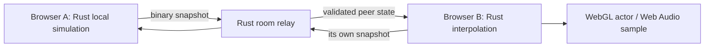

# Rust browser multiplayer implementation

This is an authored four-player Freeride baseline, building on the original
four-player/host-controlled experience documented in [original research](MULTIPLAYER_ORIGINAL.md).
It does not execute PS2 network code or emulate the disc executable.

## Authority and latency

Each player simulates their own quad in Rust at the established local cadence;
controls do not wait for a network round trip. The host owns the lobby's map and
start. A Rust Cloudflare Durable Object authenticates the creator's private token,
assigns participant slots, validates shared binary packets and relays snapshots.
The room code and invite URL contain no host credential. Host departure ends the
room; reconnect/migration, competitive authority and player-to-player collision
resolution are not part of this first component.

Twenty snapshots per second include source mechanical and rider node matrices,
quad/rider world poses and velocities, riding/air/crash states, engine telemetry
and a deduplicated crash serial. QR decomposition retains original suspension
shear. Rust interpolation uses shortest-arc quaternions and an 80ms presentation
buffer, with a 100ms extrapolation cap and a one-second stale marker. State changes,
large teleports, actor changes, slot reuse and lobby epochs reset interpolation.
The design trades a small remote presentation delay for smoother motion; it
cannot promise instant remote response or remove Internet latency. WebSockets
also retain TCP head-of-line blocking. Datagram/WebRTC transport and host/server
physics reconciliation remain later options once actual measurements justify them.

The full 27-node ATV plus male 18/female 27 poses encode to 2,520/2,988 bytes. At the
20Hz target that is 50.4/59.76kB/s per sender before protocol/TLS overhead. Four
participants can receive about 179.28 kB/s with three female peers. Browser transport
drops unsent snapshots when buffered data reaches 32 KiB, allows one outstanding
snapshot/presentation request and bounds incoming work to 64 messages. It never
queues old drive inputs or PCM. Rust handles decoder bounds and server identity;
browser JavaScript is socket, DOM/WebGL and Web Audio API glue.

## Models and sound

The garage exposes all 26 original in-race quads with their own PHY, AO/AR collision,
mechanical linkage and material resources, plus the male/female mesh and matching
78-motion catalogs. This is a browser selection adaptation; original unlock/profile
rules are not reconstructed. Exact 25 labels and unlisted ATV06 are documented in
[model evidence](MULTIPLAYER_MODELS.md). The existing port's default ATV01 is retained.

Remote actors use separate GPU geometry/texture ownership and sender node poses,
including the detached rider's independent world transform during a wreck. Audio
uses the selected original per-quad engine banks and recovered spatial arithmetic
for distance, stereo pan and Doppler. Rust selects samples; Web Audio transports
local PCM. Crash serials drive original body-impact samples at the rider position.
Pause/focus cancels local drive and publishes a stationary pose; stale/left peers
lose voices. Per-rider vocal fidelity, original multiplayer mixer budget, clothing
presets and original PS2 rendering/animation parity remain unverified.

## Verification and deployment

Pure protocol tests use synthetic malformed/bounded packets and clock/sequence
rollover, quaternion/shear reconstruction, discontinuities and stale handling.
Native private-resource probes cover all 26 quads and both rigs’ 3,276 sampled poses.
Rust adapter tests cover roster/model authority, pose lifetime and silent rendering.
Browser bridge tests cover asynchronous session isolation, backpressure, cleanup,
pause and audio lifecycle. Opt-in `tools/test_multiplayer_relay.mjs` exercises the
Rust service with the Rust codec; `tools/test_multiplayer.mjs` exercises actual
WASM/content, two-player link admission, different rigs, movement and departure.
`ATV_MP_WRECK=1` adds a real-touch failed-stunt/detached-rider/recovery check.

GitHub CI packages the authored frontend and compiled Rust relay as one checked
artifact, then deploys both through the existing game Worker. Its deployment entry delegates
room routes to the compiled Rust module and exports the Rust Durable Object. Original
resources and screenshots remain in a separately validated R2-only manifest; the
expanded package is lazy for other quad archives. `/multiplayer/version` identifies
the checked relay commit/WASM hash through configuration, while public browser
checks verify actual socket/game operation. Host checks are not a public release.

## Public integration evidence

Main `ceee73d44bc69f940729c5fdf20b892e4394bb59` and CI `38300517282` are
verified through the production HTTPS app. The relay's identity and all authored
static/R2 object hashes match their checked packages. Eleven live public room
gates cover capacity, authentication/identity, packet validation, rate limits and
cleanup. A real copied-invite two-client session replicates movement, original
spatial engine/impact audio, 390px touch-driven crash, detached rider and recovery.
An actual four-browser session gives each client three remote actors/engine voices
and propagates each rider's movement to all observers; host-end clears every guest.
All 26 garage choices also drive through actual public UI with alternating rigs.

Opt-in browser gates are `tools/test_multiplayer.mjs`,
`tools/test_multiplayer_four.mjs` and `tools/test_player_models.mjs`; original game
content is supplied only by the separate approved manifest or private host server,
never CI. The four-client timing sample uses one Mac, Chromium Metal, 1280×896 and
synthetic focus: 71.59–74.14 FPS, 2.47–2.92ms render CPU, 2.1–4.3ms physics worker
round trips and 37–201ms relay RTT (final 42–47ms). Headless/backend/device/workload
and location matter; these numbers do not establish performance on other devices.
See `DEPLOYMENT.md` and the public dev log for broader checks and limitations.

## Ninth-map integration

Vancouver Ridge (`FREE05`) joins the stable Rust catalog as map ID 9, after
`env01`–`env08`. The Rust protocol/relay share that catalog and reject ID 10;
the WASM adapter derives environment keys and next-map choices for the browser.
This extends supported values without changing packet layout. Public main
`cef26f4495f0c5dbf6f8398133ea81bf4b78aed3` / CI `38307658534` passes actual
copied-link two-browser Vancouver driving/audio/cleanup plus 13 live relay cases,
including all-four map selection and invalid-map rejection. Host closure during
asset loading keeps the completed old load on Multiplayer without reviving its
room or resuming a disconnected ride. All authored files, the Rust relay hash and
402 served objects match checked packages through HTTPS.

The merged renderer also passes four actual public clients, each with three
finite remote actors, 39 remote draws and three engine voices. All four drivers'
movement reaches every observer; host-end clears guest rooms and pose/audio/GPU
caches. A real 390px touch failed stunt records 403 guest frames across riding,
airborne and wreck, including 42 detached-rider frames and 14 impact-audio frames
with changing pan, then recovery. The four-client 12-second sample on one Mac,
headless Chromium Metal, 1280×896 and synthetic focus is 71.00–75.86 FPS,
25.9–27.2ms frame p95, 2.61–3.11ms render CPU, 2.1–6.6ms physics round trip and
41–52ms relay RTT. Concurrent validation workload was not measured; this is not
a general device or Internet performance claim.

Shared dynamic-world clocks and server/host physics reconciliation remain future
work: this baseline relays riders' owned simulations while scene animations and
dynamic objects run on each client's local scene clock. Competitive authority,
player collision, host migration and original online/race rules are unfinished.
